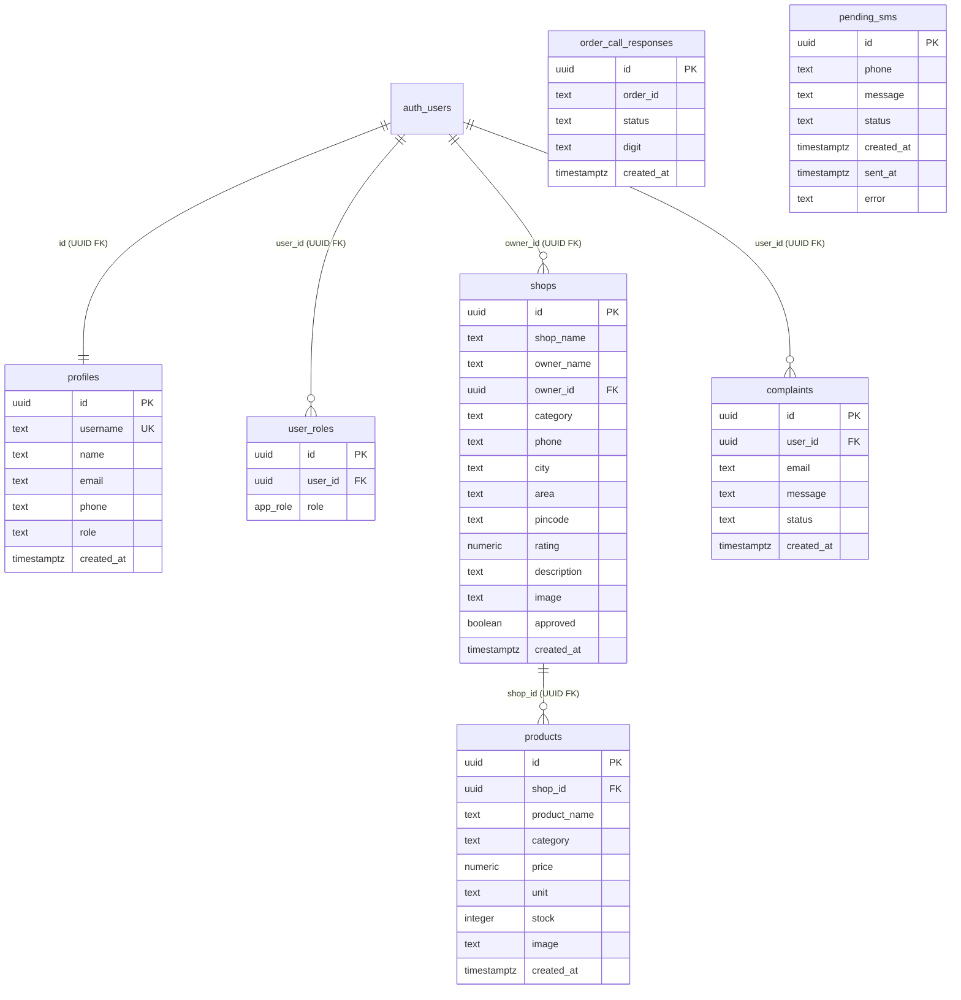

# DATABASE & DATA INTEGRITY REPORT: VENDOR+

**Auditor:** Principal Database Architect & Data Integrity Lead  
**Audit Date:** October 18, 2026  
**Audited Target:** `vendorplus-main` (Supabase / PostgreSQL Schema & Migrations)  
**Certification Target:** Database Schema, Referential Integrity, RLS Policies, and Data Persistence  

---

## 1. Executive Summary

A comprehensive architectural and schema analysis was performed across all 15 PostgreSQL migrations (`supabase/migrations/*.sql`), trigger definitions, Row Level Security (RLS) policies, and application data layers.

| Subsystem / Metric | Audit Finding | Status | Severity |
| :--- | :--- | :--- | :--- |
| **Orders Persistence** | **NO `orders` table exists in PostgreSQL schema** | **FAIL** | **CRITICAL** |
| **Order Items Persistence**| **NO `order_items` table exists in PostgreSQL schema** | **FAIL** | **CRITICAL** |
| **RLS Policy on `profiles`** | `Allow username lookup for login` grants `anon` full table read | **FAIL** | **CRITICAL (Security/PII)**|
| **Shop & Product Schema** | Normalized with UUID PKs and FK constraints | **PASS** | Info |
| **Role-Based Access Control**| PostgreSQL `app_role` enum and `SECURITY DEFINER` function | **PASS** | Info |
| **Account Limit Enforcement**| PL/pgSQL function `check_account_limit()` (Max 2 accounts) | **PASS** | Info |
| **Data Persistence on Reload**| Orders vanish upon browser refresh (memory-only state) | **FAIL** | **CRITICAL** |

---

## 2. Schema Inventory & Entity-Relationship Architecture

The existing PostgreSQL migrations define 7 tables:



---

## 3. Critical Architectural Defects

### 3.1 Ghost Entity: Missing `orders` and `order_items` Tables (`DEFECT-DB-01`)
- **Discovery:** Despite being advertised as a "hyperlocal ordering platform", there is **no database table for customer orders** in any migration.
- **Evidence:** 
  - `Select-String -Path "supabase/migrations/*.sql" -Pattern "orders"` reveals zero tables named `orders`.
  - In `src/lib/order-context.tsx`, `orders` are instantiated strictly in React memory:
    ```ts
    const [orders, setOrders] = useState<Order[]>(demoOrders);
    ```
  - The `placeOrder()` function assigns a local mock ID (`o_${Date.now()}`) and appends to client state.
- **Consequence:** 
  - Refreshing the browser or opening another tab wipes all newly placed customer orders.
  - Shop owners cannot see orders placed by actual customers on other devices.
  - The database is completely disconnected from the primary commercial workflow.

### 3.2 PII Exposure via Flawed RLS Policy (`DEFECT-DB-02`)
- **Migration:** `20260308230955_2bf082a0-2d49-4758-886a-de7472a356b1.sql`
- **Policy Statement:**
  ```sql
  CREATE POLICY "Allow username lookup for login" ON public.profiles FOR SELECT TO anon USING (true);
  ```
- **Vulnerability:**
  - Intended purpose: Allow the client during login to resolve a username to an email address.
  - Actual outcome: `TO anon USING (true)` removes ALL row-level filters for anonymous users. Any unauthenticated client with the public anon key can run `supabase.from("profiles").select("*")` and dump all usernames, full names, phone numbers, and email addresses.
- **Required Remediation:** Drop this policy immediately. Replace with a restricted `SECURITY DEFINER` function:
  ```sql
  CREATE OR REPLACE FUNCTION public.get_email_by_username(lookup_username TEXT)
  RETURNS TEXT
  LANGUAGE sql
  SECURITY DEFINER
  SET search_path = public
  AS $$
    SELECT email FROM public.profiles WHERE username = lookup_username LIMIT 1;
  $$;
  ```

---

## 4. Referential Integrity & Constraints

1. **Foreign Keys:**
   - `profiles.id` references `auth.users(id) ON DELETE CASCADE`.
   - `user_roles.user_id` references `auth.users(id) ON DELETE CASCADE`.
   - `products.shop_id` references `shops(id) ON DELETE CASCADE`.
2. **Account Quota Constraint:**
   - Function `check_account_limit()` enforces a business rule: maximum of 2 user profiles per email or phone number.
3. **Missing Indexing Opportunities:**
   - `shops.category`, `shops.area`, and `products.category` lack B-Tree indexes, which would cause sequential scans as shop counts scale.

---

## 5. Database Integrity Verdict

- **Verdict:** **FAIL (Release Blocker)**.
- **Blockers:** 
  1. Complete absence of persistent `orders` and `order_items` tables.
  2. Severe PII data leak via anonymous `profiles` table select policy.
